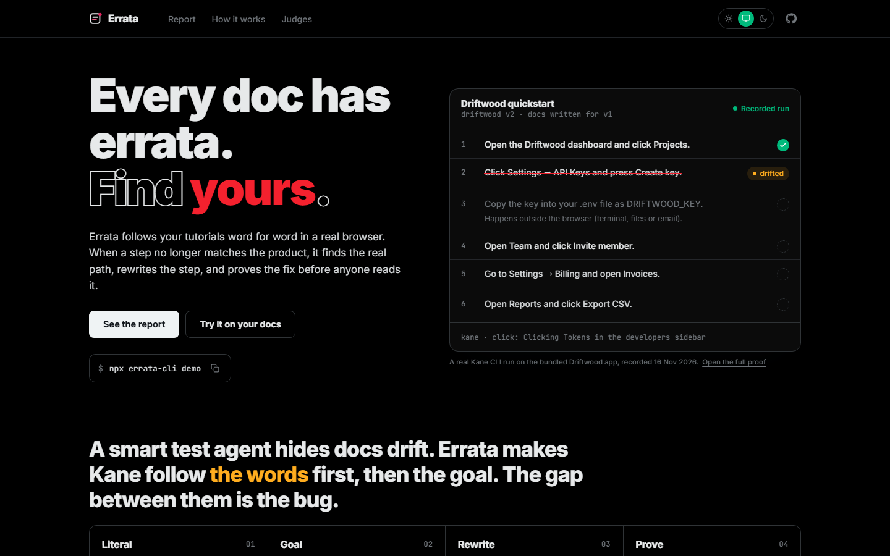
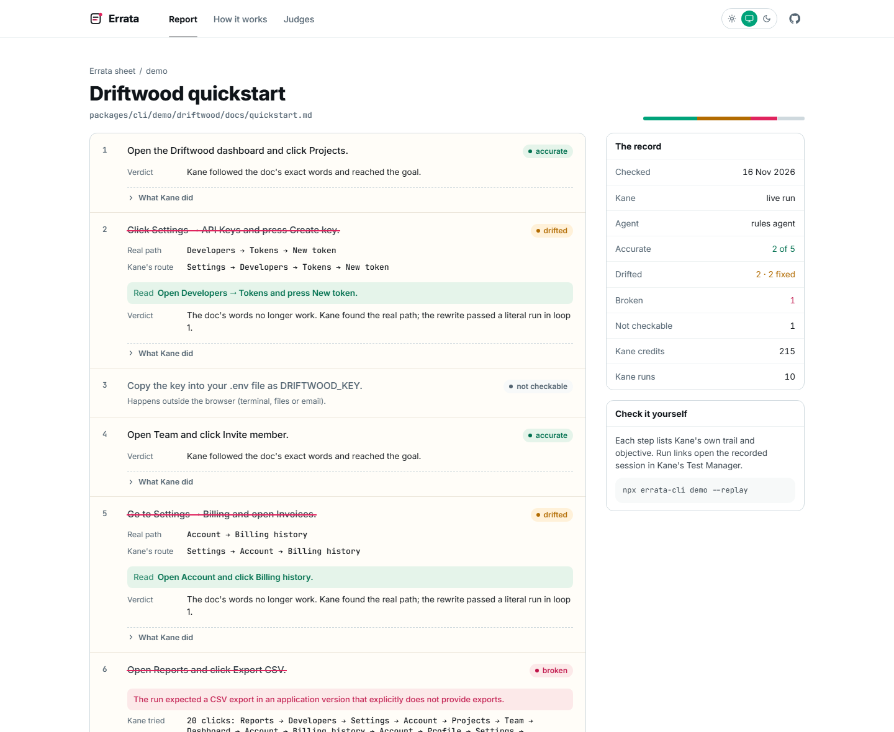

<p align="center"><picture><source media="(prefers-color-scheme: dark)" srcset="docs/img/logo-white.svg"></picture></p>

<h1 align="center">Errata</h1>

<p align="center"><b>Every doc has errata. Find yours.</b></p>

<p align="center">
<a href="https://errata-nine.vercel.app">Live app</a> ·
<a href="https://youtu.be/cjgjqvsVSbA">Watch the demo (4:49)</a> ·
<a href="https://errata-nine.vercel.app/report/">Live report</a> ·
<a href="#judges-start-here">Judges, start here</a> ·
<code>npx errata-cli demo</code> ·
<a href="https://errata-nine.vercel.app/how-it-works/">How it works</a>
</p>

<p align="center"></p>

## Links

| | |
|---|---|
| 🌐 **Live app** | [errata-nine.vercel.app](https://errata-nine.vercel.app) |
| 📊 **Live report** | [errata-nine.vercel.app/report](https://errata-nine.vercel.app/report/) |
| 🎥 **Demo video** (YouTube, 4:49) | [youtu.be/cjgjqvsVSbA](https://youtu.be/cjgjqvsVSbA) |
| 📦 **npm package** | [errata-cli](https://www.npmjs.com/package/errata-cli) |
| 💻 **Source code** | [github.com/darkfallX/Errata](https://github.com/darkfallX/Errata) |
| 𝕏 **Launch post on X** | [x.com/Darkfall_x](https://x.com/Darkfall_x/status/2122707693878284477) |
| 💼 **Launch post on LinkedIn** | [LinkedIn post](https://lnkd.in/p/dj_jTGXG) |

---

Priya opens your Quickstart. Step 3 says *"Click **Settings → API Keys** and press **Create key**."*
There is no **API Keys** under Settings; a redesign moved it to **Developers → Tokens** six months ago.
She looks for ten minutes, gives up, and never comes back. Nobody on your team noticed, because the team knows the way and the tests check the product, not the words.

That's not rare. In a survey of 202 developers at All Things Open 2025, **73% said their first move with a new tool is a quickstart or tutorial**, and **17% said bad docs make them abandon a tool** ([Catchy, Nov 2025](https://www.catchyagency.com/post/what-202-open-source-developers-taught-us-about-tool-adoption); an informal 90-second booth survey, so read it as directional).

**Errata follows your tutorials word for word in a real browser with [Kane CLI](https://www.testmuai.com/kane-cli/).** When a step no longer matches the product, Kane finds the real path, the agent (Claude Code, or an offline rules agent) rewrites the step, and Kane proves the rewrite before anyone sees it. If Kane can't follow the rewrite, its reason goes back to the agent.

What `npx errata-cli demo --replay` prints (recorded live Kane CLI runs, 16 Nov 2026):

```
  Errata · Driftwood quickstart

   1  Open the Driftwood dashboard and click Proj…  ● accurate
   4  Open Team and click Invite member.            ● accurate
   2  Click Settings → API Keys and press Create …  ● drifted
        docs say   S̶e̶t̶t̶i̶n̶g̶s̶ ̶→̶ ̶A̶P̶I̶ ̶K̶e̶y̶s̶ ̶→̶ ̶C̶r̶e̶a̶t̶e̶ ̶k̶e̶y̶
        real path  Developers → Tokens → New token  found by Kane
                   Kane's full route: Settings → Developers → Tokens → New token
        rewritten  Open Developers → Tokens and press New token.
        re-proven  ● literal pass on the rewrite  1 loop
   3  Copy the key into your .env file as DRIFTWO…  ○ not checkable
        Happens outside the browser (terminal, files or email).
   5  Go to Settings → Billing and open Invoices.   ● drifted
        docs say   S̶e̶t̶t̶i̶n̶g̶s̶ ̶→̶ ̶B̶i̶l̶l̶i̶n̶g̶ ̶→̶ ̶I̶n̶v̶o̶i̶c̶e̶s̶
        real path  Account → Billing history  found by Kane
                   Kane's full route: Settings → Account → Billing history
        rewritten  Open Account and click Billing history.
        re-proven  ● literal pass on the rewrite  1 loop
   6  Open Reports and click Export CSV.            ● broken
        unreachable The Reports page states that exports are unavailable, so a CSV download cannot be p…

  2 of 5 checkable steps accurate · 2 drifted, 2 fixed and proven · 1 broken
```

The two proven rewrites then ran together as one Kane `_test.md`, and it **passed**.

## Judges, start here

| | What you see | Sign-in | Time |
|---|---|---|---|
| **A** | `npx errata-cli demo`: the bundled Driftwood app, its v1 docs walked against its v2 UI. Accurate, drifted and broken steps, and fixes proven by Kane. | Kane CLI login (or add `--replay`: no sign-in, no credits) | ~9 min live · 20 s replay |
| **B** | [The errata sheet](https://errata-nine.vercel.app/report/): real public tutorials walked word for word, each step with Kane's own trail, objective and run link. | None | 2 min |
| **C** | [One proof sheet](https://errata-nine.vercel.app/t/driftwood/quickstart/): literal run → goal run → rewrite → proof → patch, for every step. | None | 1 min |
| **D** | [The closed loop with Claude Code](#the-closed-loop-live-with-claude-code-26-nov-2026): what Kane told the agent and what the agent wrote back, three loops, unedited. | None | 1 min |

`--replay` plays back **recorded real Kane runs** that ship in the package, and it is labelled as a replay everywhere it appears. Without `--replay`, every run is live.

## The closed loop, live with Claude Code (26 Nov 2026)

`--agent claude-code` puts your coding agent in the loop: every rewrite is a headless Claude Code call (`claude -p`, signed in with your own plan, no API key), and every Kane failure goes back to it in the next call. Each report keeps the whole conversation, word for word, in `agent_calls`.

Here is one step, unedited ([report](runs/2026-11-26/claude-code/hunt/reports/how-to-geek-2010-make-a-book-from-wikipedia-articles.json)). How-To Geek (2010) says *"click **Create a book** under **Print/export** on the left sidebar"*. That link is gone. Kane reached the book page another way: **Search → Special:Book**.

| Loop | Claude Code wrote | Kane's literal run said (sent back to Claude Code) |
|---|---|---|
| 1 | "type **Special:Book** into **Search**…" | failed: it looked for "Special:Book" on the article page, though the text must first be entered in the search box |
| 2 | "click the **Search** box…, type Special:Book into it, and press Enter…" | failed: the instructions required a search term but prohibited entering it |
| 3 | "click **Search**…, enter **Special:Book** as the search term, and click **Search** again…" | failed: typing is prohibited |

No fix shipped, and that's the point: Errata publishes a rewrite only when Kane can follow it word for word. Kane's last two answers also told *us* something: Errata's literal runs forbid typing, so a step that needs a search box can't be proven yet. That limit is now listed [below](#limits-stated-plainly).

| Run (live Kane, Claude Code as the agent) | Result | Kane credits |
|---|---|---|
| Driftwood demo | 2 drifted steps, both rewritten by Claude Code and proven by Kane on loop 1; 1 broken; 2 accurate | 270 |
| 6 drift-hunt tutorials | the same 3 Wikipedia fixes the rules agent found, worded the way a writer would (*"open the **Tools** menu to see the print and export options"*), each proven on loop 1; 1 still needs a human (above); 1 false fix caught in review and rejected | 748 |

Claude Code didn't find fixes the rules agent missed; it wrote clearer ones and used Kane's feedback the way the loop intends. The false fix: How-To Geek's book step 2 was checked after step 1 had already switched Wikipedia's book creator on, so a strange route got "proven". That's an Errata limit with steps that depend on state, not a docs error, and it's rejected in [`review.json`](runs/2026-11-26/claude-code/review.json). Everything is in [`runs/2026-11-26/`](runs/2026-11-26/claude-code/).

## The public run (16 Nov 2026)

We walked **24 published tutorials, 44 checkable steps**, from GitHub Docs (15), Wikipedia Help (5), Grafana (2), Plausible (1) and OpenStreetMap (1), with Kane CLI, live. Selection rule and every quote: [`corpus/`](corpus/). Reports, recordings and the review: [`runs/2026-11-16/`](runs/2026-11-16/).

| | Steps |
|---|---|
| Accurate on the first run | 42 |
| Flagged (drifted or broken) | 2 |
| Confirmed docs errors | **0** |
| False alarms (both Errata's bugs, both fixed) | 2 |
| Kane credits | 889 |

**Both flags were our bugs, not the docs'.** One: Errata asked Kane to note the page heading, and GitHub's raw file view has none, so a correct click on **Raw** failed. Two: GitHub's file view has a **Code** toggle *and* a **Code** repository tab; given only the label, Kane clicked the tab, and the next step started on the wrong page. Both are fixed: the heading is optional, and Kane now gets the doc's own sentence as context. A re-run of both tutorials came back fully accurate ([`runs/2026-11-16/rerun/`](runs/2026-11-16/rerun/)). The review is in [`review.json`](runs/2026-11-16/review.json): reviewed against Kane's evidence and the live pages, approved by Darkfallx.

**Correction (26 Nov).** 3 of the 42 "accurate" steps above had failed the word-for-word run and were passed by a rule that treated a lookalike route as a flaky run. We removed that rule (a lookalike route now gets one more literal run, and only a pass counts) and re-walked those 3 steps live ([`runs/2026-11-26/recheck/`](runs/2026-11-26/recheck/)):

| Step | Re-walk | Review |
|---|---|---|
| GitHub contributors graph, step 4: click **Period: All** | the button now reads **Period: Last 3 months**; a rewrite with that label passed | likely a real docs change, pending review |
| GitHub branches, step 2: open the branch dropdown, click **View all branches** | flagged, because the dropdown has no label to follow | Errata's false alarm |
| GitHub line-by-line history, step 4: click **Preview** | flagged, because the step began outside a Markdown file | Errata's false alarm |

So the public run is really **39 proven accurate, 1 likely docs change and 4 false alarms**, all from Errata. The 2 Wikipedia steps the same rule had passed in the drift hunt were re-proven word for word on 26 Nov.

So: well-kept docs from big projects stayed accurate, and we publish the false alarms rather than a flattering number. The Driftwood demo is where you can watch drift get caught, fixed and proven.

### The drift hunt: older third-party tutorials

Then we went looking for drift on purpose. We picked **6 older third-party tutorials** (How-To Geek 2010, SmartCompany 2011, Vancouver Editor 2011, labnol 2015, Dignited 2019) whose Wikipedia instructions predate Wikipedia's 2022 redesign, and walked them the same way, quoting each sentence exactly. *This sample is biased on purpose, so its numbers say nothing about docs in general.*

| Tutorial · step (exact words) | Errata | Review |
|---|---|---|
| How-To Geek (2010): "click the **Print/export** link on the left sidebar in Wikipedia" | drifted → *"Click **Tools**."* proven by Kane; the next step (Download as PDF) then works as written | confirmed · fix good |
| SmartCompany (2011): "you should see a link that says **Print/Export**" | drifted → *"Click **Tools**."* proven | confirmed · fix good |
| Dignited (2019): "Locate the **Print/export** section in the left panel of the page." | drifted → *"Click **Tools**."* proven | confirmed · fix good |
| How-To Geek (2010): "click **Create a book** under Print/export on the left sidebar" | drifted · no rewrite passed in 3 loops | confirmed · needs a human |
| labnol (2015): "choose **Book Creator** from the toolbox menu in the right sidebar" | drifted · no rewrite passed in 3 loops | confirmed · needs a human |
| Vancouver Editor (2011): "**Tools** … **Cite this page**" | accurate | still right |

So the hunt found **5 real wrong steps**, with **3 Kane-proven fixes**, and it said "needs a human" for the 2 it could not fix cleanly.

**Against the usual way of testing:** on all 5 of those wrong steps, Kane's lenient goal run ("reach this page by any route", which is how an agent test is normally written) **passed**. A goal-only test would have called all 5 fine. Errata's word-for-word run caught all 5. It's a small sample, and every run is in [`runs/2026-11-16/reports/`](runs/2026-11-16/reports/) (`literal.status` against `goal_pass.status`). No false alarms in the hunt. Reviews: [`review.json`](runs/2026-11-16/review.json) (the 3 proven fixes are approved by Darkfallx; the 2 "needs a human" verdicts are pending approval).

**We caught ourselves, too.** The tool we used to read these pages had paraphrased 15 of the 54 tutorial sentences, and our first runs used those paraphrases. We now check every quote against the live page ([`corpus/verify-quotes.mjs`](corpus/verify-quotes.mjs), 56/56 verbatim), re-walked the 11 affected tutorials, and kept the first reports in [`runs/2026-11-16/superseded/`](runs/2026-11-16/superseded/). With exact quotes, two book-creator flags from the first runs disappeared.

## The insight

> **A smart test agent hides docs drift. Errata makes Kane follow the words first, then the goal. The gap between them is the bug.**

Ask an AI browser agent to "click API Keys" when the menu moved, and a good agent finds Tokens anyway and passes. Your test is green, your doc is wrong. In the drift hunt, Kane's goal-only run passed **5 of 5** confirmed wrong steps; the literal run failed all 5. So every step runs as two passes:

| Pass | Kane mode | What Errata asks | What it tells us |
|---|---|---|---|
| **Literal** | `--mode action` (strict) | Click exactly these labels, in order, nothing else | Do **the words** still work? |
| **Goal** (only if Literal fails) | `--mode testing` (lenient) | Reach the step's goal by any route | Is **the goal** still reachable, and *how*? |

- Literal passes → 🟢 **accurate**
- Literal fails, Goal passes → 🟡 **drifted**. The route Kane took *is* the fix.
- Both fail → 🔴 **broken**. Escalated to a human, with the evidence.

Then the closed loop: **the agent rewrites the step from Kane's real path → Kane runs the rewrite literally → if it fails, Kane's reason goes back to the agent**, up to three loops. A fix is proposed only once Kane passes it.

<p align="center"></p>

## How Kane is used

```
 doc (URL / .md / .tutorial.json)
   │  agent extracts steps: quote · labels · goal · checkable · continues
   ▼
 ┌─ per step ─────────────────────────────────────────────────────────────────┐
 │ kane-cli run "<ordered single clicks>" --agent --mode action   ─▶ Literal │
 │        │ run_end.status, + clicks read from the sealed .evidence pack      │
 │        ▼ fail                                                               │
 │ kane-cli run "Goal: <end state>" --agent --mode testing                    │
 │        --bug-detection continue                                 ─▶ Goal    │
 │        │ the real path = the clicks in Kane's evidence pack                 │
 │        ▼                                                                    │
 │ agent rewrite (only labels Kane clicked; guard enforced in code)            │
 │        ▼                                                                    │
 │ kane-cli run "<rewrite as single clicks>" --agent --mode action ─▶ Proof   │
 │        └── fail: Kane's one_liner → agent → loop (≤ 3)                      │
 └─────────────────────────────────────────────────────────────────────────────┘
   ▼
 report.json · report.md (PR comment) · patch.diff · <name>_test.md (a Kane test of the fixed tutorial)
```

- Errata always runs Kane with `--agent` (NDJSON) and acts only on `run_end`: `status`, `one_liner`, `reason`, `verdict`, `credits_consumed`, `final_state.url`, `test_url`. Exit codes 0/1/2/3 map to passed / failed / unchecked / timeout.
- **What Kane clicked is read from its sealed evidence pack** (`tests/*/logs/*-actions.ndjson`: one record per action with the Playwright selector, e.g. `internal:role=link[name="Invite member"i]`), not from a value Kane is asked to write down. More on why below.
- A step starts where a reader would be: steps that continue on the previous page start at the previous step's real end URL (`final_state.url`). Independent steps start at the tutorial's start URL and run in parallel (`--parallel 3`).
- Proven tutorials are saved as Kane `_test.md` files (`kane-cli testmd run`). The fixed Driftwood tutorial passed as one, twice in a row. (We expected the second run to replay from Kane's cache; on our runs it re-authored and took as long, so we don't claim a cache.)

## What we found building it

1. **One rule per click, not one rule for all.** Our first literal objective said *"fail if any of these labels is missing."* Kane checked all three labels on the first page, before clicking anything, and failed the step for the wrong reason (its own triage said `agent_misstep`). The literal pass is now an ordered list of single clicks with no global condition. `--mode action` stops on the first missing element.
2. **Strict mode still explores.** Asked to click "API Keys", Kane in `--mode action` opened Settings, then Account, then Developers, then Tokens, looking for it. It failed correctly, but it shows why a single lenient pass hides drift.
3. **"Store what you clicked" reads the screen, not the history.** We asked Kane to store its click path as `clicked_path`. It extracted that value from the page. On one run that clicked Team → Invite member, it stored `Settings→General`. On another it renamed the key to `navigation_path`. So Errata reads the clicks from the evidence pack's action log, which is ground truth.
4. **Setup text pollutes the path.** "First get to X by any route" put the setup clicks into the real path. So there is no setup text: steps chain on real end URLs instead.
5. **Kane's triage is a signal, not a verdict.** On a moved menu, Kane labels the literal failure `automation_bug / agent_misstep`, because from its side the label simply isn't there. Errata decides drift from the goal pass, not the triage.
6. **Look-around clicks.** On the goal pass Kane sometimes clicks a top-nav item, looks, and moves on. Loop 1 of the rewrite drops consecutive clicks in the same header row; if Kane can't prove that version, loop 2 uses the full path. Kane's proof decides.
7. **One button, three names.** GitHub's activity filter shows "All activity", but the evidence pack records its accessible name, `Filter by activity type: All`. Our first matcher flagged that passing step as drift. Each click now keeps every name Kane recorded (Kane's own description, the element text and the accessible name), and any of them can match. The label shown to readers is the visible one.
8. **A crash is not a broken doc.** Running too many headless Chromes on GitHub's heavy pages ran the machine out of memory. Kane reported it honestly (`reason_code: infra_error.screenshot_failed`, triage `environment_issue`). Errata now retries such runs once, then marks the step **unchecked**, never broken. The public run uses at most two Kane runs at a time.
9. **Kane's test.md format.** A `## heading` names a step and the text under it is the instruction. Our first export put the instruction in the heading, so Kane only checked the "Verify" line. The export now writes `## Step n: …`, then the instruction, then `Verify that …`. The fixed Driftwood tutorial then passed as one Kane test.
10. **The same label, twice.** In the public run Kane clicked the repository's **Code** tab when the doc meant the file view's **Code** toggle, since we had only told it the label. Each literal objective now carries the doc's own sentence as context for *where* the label is (context, not a pass/fail rule).
11. **Not every page has a heading.** We asked Kane to note the page heading after each step. A raw text file has none, so a correct click failed. It's optional now.
12. **Check your quotes, not just your runs.** The web-reading tool we used to collect tutorials paraphrased some sentences, and we treated the paraphrase as a quote. Errata gives Kane the doc's own sentence as context, so the exact wording matters. `corpus/verify-quotes.mjs` now checks every quote against the live page before a run.

## Honesty rules (enforced in code)

- A rewrite may only use UI labels that appear in Kane's real path or the heading it landed on (`guardRewrite`). It checks both the labels the agent reports and every **bold** or "quoted" label in the sentence it wrote, so a rewrite that invents a label is rejected before Kane runs it.
- Shell commands, file edits and "check your email" steps are **not checkable**. They are shown as such and never counted as passed.
- When Kane itself can't run (sign-in, network, Chrome), the step is **unchecked** and never counted as a docs finding.
- Replays are real recorded runs, labelled as replays. A missing recording is an error, never a made-up result.
- In the public run, every 🟡 and 🔴 is reviewed against the live page and the evidence, the reviewer is named, and false alarms are published ([report](https://errata-nine.vercel.app/report/#precision)).

## Install

Errata needs [Kane CLI](https://www.testmuai.com/support/docs/kane-cli-installation/), signed in, plus Node 18+ and Chrome.

```bash
npm i -g @testmuai/kane-cli && kane-cli login
npx errata-cli doctor
```

**CLI**

```bash
npx errata-cli check https://docs.example.com/quickstart          # one tutorial page
npx errata-cli check https://docs.example.com --crawl 20          # the first 20 tutorials it links to
npx errata-cli check ./docs/quickstart.md --app http://localhost:3000   # docs-as-code, {{app}} filled in
npx errata-cli check ./corpus/tutorials/*.tutorial.json           # steps pre-extracted by a coding agent
npx errata-cli fix .errata/reports/quickstart.json --pr           # apply proven rewrites, open a PR (gh)
npx errata-cli demo [--replay]                                    # the judge path
```

Outputs go to `.errata/`: `reports/*.json`, `reports-md/*.md`, `patches/*.diff`, `tests/*_test.md`, `recordings/*.json`.

**Agent.** Three choices, one honesty guard:

- `--agent claude-code`: your signed-in [Claude Code](https://claude.com/claude-code) CLI reads the docs and writes the rewrites, and gets Kane's failures back. No API key needed. (In the repo now; `npx errata-cli` still ships 0.1.1 without it, so run it from source: `node packages/cli/dist/cli.js`.)
- `--agent claude`: the Claude API (`claude-opus-5-5`, structured outputs), used automatically when `ANTHROPIC_API_KEY` is set.
- `--agent rules`: deterministic and offline, for numbered, bold-label docs like most quickstarts. The default without a key.

**GitHub Action**: fail a docs PR when a tutorial breaks, and comment with the proven fixes. (Not yet run on a real pull request.)

```yaml
- uses: darkfallX/Errata/packages/action@main
  with:
    docs: docs/**/*.md
    app-url: ${{ steps.preview.outputs.url }}
    fail-on: broken            # or: drifted
  env:
    KANE_USERNAME: ${{ secrets.KANE_USERNAME }}
    KANE_ACCESS_KEY: ${{ secrets.KANE_ACCESS_KEY }}
```

**Agent skill**: so a coding agent that just changed the UI checks the docs too.

```bash
npx errata-cli skill                      # installs /errata into ~/.claude/skills; then: /errata I renamed the Billing menu
```

## Limits, stated plainly

- Tutorials behind a sign-in aren't supported yet (Driftwood covers the logged-in style locally).
- Shell, file and email steps are not checked, and say so.
- Each Kane run costs credits (about 20 on our runs); the goal pass and proofs only run on failures.
- The rules agent needs numbered steps with **bold** or "quoted" UI labels. Prose-heavy docs need the Claude agent, or pre-extracted `*.tutorial.json`.
- Icon-only buttons (no visible label) can't be followed literally, because there are no words to follow.
- Steps that need typing (a search box, a form field) can't be proven yet: the literal run only clicks. Kane told us so on the How-To Geek book step.
- Each step starts in a fresh browser at the right URL; state such as a switched-on mode or a cookie is not carried between steps. Steps that depend on that state can be flagged wrongly (see the drift hunt).
- If Kane's route contains the doc's labels in order but needs an extra click the doc doesn't mention (say, opening a menu first), the step counts as **accurate**. Errata checks labels, not completeness.

## Repository

```
packages/cli/            errata-cli (TypeScript)
  src/engine.ts          the closed loop and scheduling
  src/objectives.ts      the exact words given to Kane
  src/kane.ts            kane-cli runner (live, recorded, replay)
  src/evidence.ts        reads clicks from Kane's sealed evidence packs
  src/agent.ts           Claude Code, Claude API and rules agents, honesty guard
  prompts/               extraction and rewrite prompts
  demo/driftwood/        the deterministic demo app (v1/v2) and its docs
  demo/recordings/       recorded real Kane runs for --replay
packages/action/         GitHub Action
packages/cli/skill/      Claude Code skill (npx errata-cli skill installs it)
corpus/                  the public run list, the selection rule, extracted tutorials
runs/<date>/             public run reports and the hand review
site/                    the report site (static, built from report.json)
```

```bash
npm install && npm run build && npm test     # 24 tests, no network or credits needed
node site/extract-shots.mjs                   # copies Kane's screenshots out of local evidence packs
npm run site                                  # builds site/out from the reports
```

MIT · Built for the [KaneCLI hackathon](https://kaneclihack.sh) on Kane CLI by TestMu AI.
